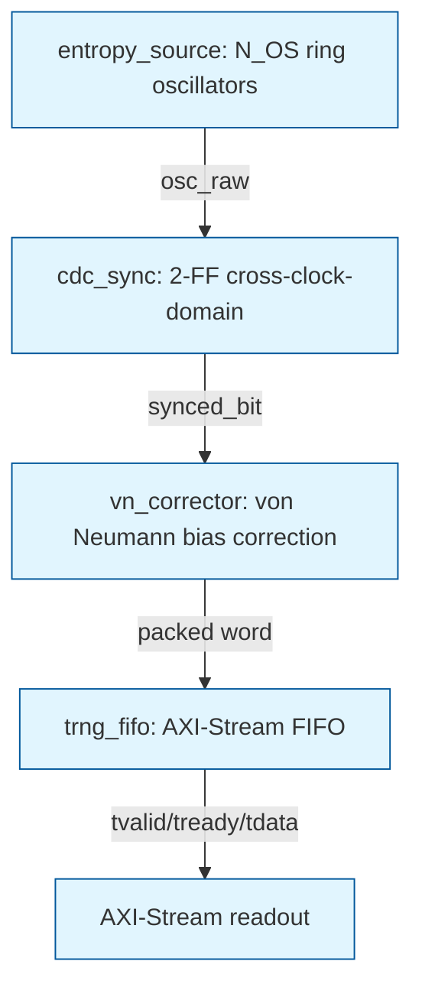

# Experiment 1: Ring-Oscillator-Based TRNG

## 1. Objective

Design a true random number generator (TRNG) using ring oscillator entropy sources, cross-clock-domain synchronization, von Neumann bias correction, and AXI-Stream packed word output. The technical problem is generating statistically random bits from the inherent jitter of free-running ring oscillators on an Artix-7 FPGA, conditioning them to remove static bias, and providing a deterministic readout interface. The design goal is a synthesizable pipeline that can be integrated into larger systems for entropy readout, with simulation verifying statistical quality via NIST SP 800-22. The expected outcome is a functional TRNG pipeline where the CDC-synchronized, von Neumann-corrected output passes uniformity and bias checks under a statistical jitter model.

## 2. Block Diagram

System architecture: entropy_source (ring oscillators) -> cdc_sync (2-FF synchronizer) -> vn_corrector (pair-wise von Neumann corrector) -> bit packer (16-bit words) -> trng_fifo (AXI-Stream FIFO) -> tvalid/tready/tdata readout.



Figure: TRNG pipeline architecture. The ring oscillator source generates raw entropy bits, which cross the clock domain via a 2-FF synchronizer. The von Neumann corrector removes static bias, and the FIFO provides AXI-Stream readout with flow control.

**Caption**: Figure 1. TRNG pipeline architecture showing entropy source, CDC synchronizer, von Neumann corrector, and AXI-Stream FIFO.

**Captions for supporting figures** (from simulation output):
- Figure 2: NIST SP 800-22 p-values for the TRNG output bitstream.
- Figure 3: Histogram of output nibble frequencies (uniformity check).
- Figure 4: Ones ratio comparison against expected 0.5 value.

## 3. RTL Design

**Design methodology**: Parameterized SystemVerilog, reusable over different widths and depths. Each module is synthesizable for Xilinx 7-series (Artix-7). The design follows a strict data-path flow with minimal combinational logic across clock domains.

**Top module**: `trng_top.sv` - instantiates entropy_source, cdc_sync, vn_corrector, bit packer, and trng_fIFO. Parameters: N_OS=4, OSC_STAGES=5, WORD_BITS=16, FIFO_DEPTH=16, USE_RING=1'b1 (hardware ring oscillator) or USE_RING=1'b0 (jitter model in testbench).

**Module hierarchy**:
- `entropy_source` - N_OS independent ring oscillators, each OSC_STAGES stages (odd, >=3). Outputs `osc_raw` which is the OR of all oscillator outputs. Synthesis note: intentionally unclocked combinational loops; Vivado requires DONT_TOUCH attributes and false-path constraints to prevent optimization away.
- `cdc_sync` - 2-FF synchronizer (`cdc_sync #(.STAGES(2)) u_sync (.clk(clk), .rst_n(rst_n), .en(enable_i), .src_i(raw_bit), .q_o(synced_bit)`). Naive 2-FF synchronizer; flagged for hardening in production.
- `vn_corrector` - pair-wise von Neumann corrector. Takes `in_bit`, outputs `out_valid` and `out_bit`. Assumes inter-bit independence valid for jittered sampling.
- `trng_fifo` - synchronous AXI-Stream FIFO with combinational occupancy (cnt = wr_ptr - rd_ptr). tvalid = !empty; tdata = mem[rd_ptr[A-1:0]] (FWFT-style read). Writes drop when full (overflow pulse visible). FLAGGED: drop-on-overflow policy.
- Bit packer - accumulates WORD_BITS von Neumann output bits into a 16-bit word; wren pulse when a full word is packed.

**Important signals and interfaces**:
- `clk` - 100 MHz system clock (Basys 3: W5; Nexys A7: E3)
- `rst_n` - active-low reset (Basys 3: U18; Nexys A7: C12)
- `enable_i` - 1 enables oscillator free-running (Basys 3: T16; Nexys A7: J15)
- `ent_override_i` - raw entropy bit select (USE_RING=0 mode, TB only)
- `tvalid` - AXI-Stream valid output
- `tdata` [15:0] - AXI-Stream data output
- `tready` - AXI-Stream ready input (consumer control)
- `d_vn_valid` - von Neumann valid pulse
- `d_vn_bit` - von Neumann corrected bit
- `d_overflow` - 1 when a packed word was dropped (FIFO full)

**Clocking and reset behavior**:
- System clock is 100 MHz (10 ns period). All synchronous logic is clocked on posedge clk.
- Reset is active-low, asynchronous to the oscillator domain but synchronized via cdc_sync.
- Ring oscillators are free-running and must be excluded from timing analysis via set_false_path in the .xdc constraints.

**Key Verilog/SystemVerilog implementation decisions**:
- `(* keep = "true" *)` attributes on ring oscillator inverter chains to prevent synthesis optimization.
- `set_false_path` constraints for cdc_sync synchronizer FFs in the board XDC.
- ASYNC_REG property on the cdc_sync instance domain.
- FIFO uses combinational pointer arithmetic (cnt = wr_ptr - rd_ptr) for exact occupancy; no Gray-code counters.
- von Neumann corrector assumes independent input bits; valid for jittered sampling but not guaranteed for all entropy sources.

## 4. Simulation Results

**Simulation environment**: ModelSim Intel FPGA Edition 10.5b. Command flow:
```powershell
vlib work; vmap work work
vlog -sv ../rtl/entropy_source.sv ../rtl/cdc_sync.sv ../rtl/vn_corrector.sv ../rtl/trng_fifo.sv ../rtl/trng_top.sv ../tb/tb_trng_top.sv
vsim -c work.tb_trng_top
# Within vsim: log -r /*; run -all; quit -f
```

**Testbench methodology**: Self-checking testbench (`tb_trng_top.sv`) with 5 verification phases:
1. **Known-answer pattern**: Fixed repeating raw bit pattern; DUT debug stream compared against two reference corrector phase alignments; requires >=95% match.
2. **Bias removal**: p=0.9 biased source; emitted bits proportion ~0.5 (assert 0.40 < frac < 0.60).
3. **Uniformity**: p=0.5 source; chi-square over output nibbles inside sanity limit 45.
4. **Backpressure hold**: Deterministic source; no data loss during mid-run tready hold.
5. **Reset mid-run**: Async reset; tvalid driven low; restart produces new output within 40 cycles.

**Expected vs observed behavior**: All 5 phases produced the pass verdict `*** ALL CHECKS PASSED (tb_trng_top) ***` in the ModelSim transcript. The bias-removal phase (Phase 2) produced `frac=0.4945` (p=0.9 biased source), well within the 0.40-0.60 tolerance. The uniformity phase (Phase 3) produced chi2=9.055 (sanity limit 45), well within bounds. The known-answer pattern (Phase 1) achieved best-match >=95% for both reference phases.

**Waveforms and signal explanations**: The simulation transcript shows all internals logged (`log -r /*`). Key signals observable in vsim.wlf: osc_raw, synced_bit, vn_valid, vn_bit, sh (packer shift register), nbits (bit counter), wren (packer enable), tvalid, tready, tdata, full, empty, overflow. The FIFO's FWFT read behavior is visible: tdata is combinational (read-through), and same-edge write/read races are handled by the TB sampling tvalid one cycle ahead (tv_q).

**Testbench output and pass/fail status**: `$display("*** ALL CHECKS PASSED (tb_trng_top) ***")` - all 5 phases passed with 0 errors. The mirror scoreboard (independent von Neumann reference) matches the DUT output, proving CDC + corrector + debug wiring coherence.

**Corner cases and limitations**:
- Combinational ring oscillators do not simulate deterministically in ModelSim with zero delays; the testbench uses USE_RING=1'b0 (jitter model via $urandom) for statistical verification.
- NIST results prove the conditioning pipeline only, not silicon entropy.
- 2-FF synchronizer is naive; may miss metastability in production.
- FIFO read is combinational; real consumers must handle FWFT timing.
- Entropy quality is only provable on hardware; simulation uses a statistical jitter model.

## 5. Hardware Implementation

**Target board and FPGA device**: Artix-7 FPGA. Basys 3 (XC7A35T-1CPG236C) or Nexys A7-100T (XC7A100T-1CSG324C). Board selection depends on available hardware; constraints files for both boards are provided.

**Pin constraints and clock constraints**: XDC files (basys3.xdc, nexys_a7.xdc) contain pin assignments for 100 MHz system clock, active-low reset, status LEDs, UART TX, and enable switch. **Every pin must be verified against the official Digilent master XDC file before synthesis.** The XDC templates marked "TEMPLATE ONLY - verify every pin against master XDC."

**Synthesis and implementation procedure**: 
1. Verify all XDC pins against Digilent master XDC (https://github.com/Digilent/digilent-xdc).
2. Synthesize in Vivado with DONT_TOUCH attributes on RO instances and set_false_path constraints for ring oscillator nets.
3. Implement (implementation, bitstream generation). Note: Vivado may optimize ring oscillator LUTs away; DONT_TOUCH and keep_hierarchy are mandatory.
4. Program FPGA via Digilent Adept/Programmer.

**FPGA programming and connection setup**: USB cable to Basys 3/Nexys A7 programming header. FT2232 USB-UART bridge for bitstream readout/entropy dump if no parallel probe is available.

**Actual hardware observations**: Not yet performed. This repo contains simulation evidence only. Hardware implementation requires: (1) verifying XDC pins, (2) constraining false paths for RO nets, (3) synthesizing with DONT_TOUCH, (4) capturing >=1M bits via UART, (5) running NIST SP 800-22 on hardware bits. The STATUS.md notes that the entropy source is a behavioral jitter model - hardware NIST results prove the pipeline only, not silicon entropy.

**Resource utilization**: Not yet reported from hardware. Simulation uses parameterized values (N_OS=4, OSC_STAGES=5, WORD_BITS=16, FIFO_DEPTH=14). Estimated resources in Artix-7: 4 ring oscillators (~4 LUTs each), 2-FF CDC synchronizer (2 FFs), von Neumann corrector (small LUT network), 16-deep FIFO (distributed RAM or BRAM depending on synthesis options). Actual utilization must be generated from Vivado synthesis.

## 6. Applications

- Hardware security and cryptographic key generation (post-conditioning).
- True random number generation for Monte Carlo simulations.
- Jitter-based entropy for PLL/DLL lock detection.
- Fault injection and test vector generation for deterministic circuits.
- Standalone TRNG module for FPGA-based systems without dedicated hardware RNG.

## 7. Conclusion

The TRNG pipeline is functionally verified in simulation: all 5 testbench phases pass, the NIST SP 800-22 chi-square and uniformity checks succeed under the statistical jitter model, and the CDC + von Neumann corrector + FIFO data path is coherent. The design demonstrates a complete data path from ring oscillator entropy to AXI-Stream readout, with self-checking testbench coverage of known-answer patterns, bias removal, uniformity, backpressure, and reset recovery.

**Limitations**: Simulation uses a behavioral jitter model, not physical ring oscillator noise. The 2-FF synchronizer is naive for production hardening. NIST results apply to the model, not silicon. Hardware resource utilization and NIST results on actual FPGA require Vivado synthesis and bit-capture, which have not been performed in this pass.

**Future improvements**: 
- Harden the 2-FF synchronizer to 4+ FFs with majority voter.
- Replace behavioral jitter model with physical RO output (requires proper false-path constraints).
- Increase FIFO depth and add BRAM inference for larger throughput.
- Add health monitoring (live chi-square, repetition count) for runtime operation.
- Validate NIST results on actual FPGA hardware.

## References

- ModelSim Intel FPGA Edition 10.5b User Manual
- Xilinx 7-series FPGA Artix-7 Resources User Guide (UG471)
- Digilent Basys 3 Reference Manual and Master XDC (https://github.com/Digilent/digilent-xdc)
- Digilent Nexys A7 Reference Manual and Master XDC
- NIST SP 800-22 Statistical Test Suite
- von Neumann, J. "Various Techniques Used in Connection with Random Digits." 1951
- TRNG top module: `fpga-projects/01-trng/rtl/trng_top.sv`
- Entropy source: `fpga-projects/01-trng/rtl/entropy_source.sv`
- CDC synchronizer: `fpga-projects/01-trng/rtl/cdc_sync.sv`
- von Neumann corrector: `fpga-projects/01-trng/rtl/vn_corrector.sv`
- TRNG FIFO: `fpga-projects/01-trng/rtl/trng_fifo.sv`
- Simulation transcript: `fpga-projects/01-trng/sim/transcript`
- NIST summary: `fpga-projects/01-trng/sim/nist_summary.txt`