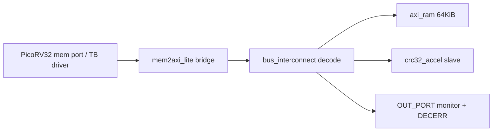

# Experiment 2: PicoRV32 RISC-V CRC Accelerator

## 1. Objective

Explain the technical problem, motivation, design goal, and expected outcome.

The problem is integrating a small RISC-V core with a memory-mapped accelerator over a correct AXI-Lite fabric, without hiding handshake edge cases. Motivation: SoC integration bugs concentrate in bus bridges, address decode, strobe handling, and response signalling. Design goal: a `soc_top` with optional PicoRV32 core (`USE_PICO=1` hardware config), `mem2axi_lite` bridge, address-decode `bus_interconnect`, 64 KiB `axi_ram`, and a `crc32_accel` slave that computes IEEE CRC-32. Expected outcome: memory-port transactions boot through the whole fabric, RAM store/load with byte-strobe merge works, and feeding ASCII "123456789" returns golden `0xCBF43926`. Simulation proves the memory contract; core-in-the-loop boot is a Vivado-only step.

## 2. Block Diagram



Figure 1. SoC architecture. The CPU memory port (valid/ready, addr/wdata/wstrb) is converted to single-outstanding AXI-Lite by `mem2axi_lite`. The interconnect decodes to RAM, CRC CTRL/DATA/RESULT, and OUT_PORT. CRC is bitwise (36 cycles/word).

**Images/block_diagram.png:** TODO — render the Mermaid above via reproducible export (Mermaid CLI / Graphviz) and save as `Images/block_diagram.png`. Do not hand-draw an unverified diagram.

Supporting genuine figures in `Images/`: `fig_axi_latency.png` (parsed from `[ST]` transaction lines), `02_riscv_soc_results.png` (summary plot).

## 3. RTL Design

Top module: `RTL/soc_top.sv` (`soc_top`, param `USE_PICO`). Actual submission top is `soc_top` — retained original name to avoid breaking `tb_soc_top` hierarchical refs (e.g. `dut.crc_busy`).

Module hierarchy (`RTL/`):
- `mem_map_pkg.sv` — address map package (`CRC_CTRL`, `CRC_DATA`, `CRC_RESULT`, `OUT_PORT`).
- `mem2axi_lite.sv` — mem_valid/mem_ready to AXI-Lite AW/W/AR/B/R; single-outstanding by design.
- `bus_interconnect.sv` — address decode, strobe routing, B2B, AW+W overlap, DECERR response.
- `axi_ram.sv` — 64 KiB BRAM-inferable RAM with byte-strobe merge.
- `crc32_accel.sv` — bitwise CRC-32 engine, CTRL reset, DATA fold (LSB first), RESULT read, busy flag.
- `external/picorv32/picorv32.v` — real PicoRV32 core (hardware config only; not compiled in ModelSim TB per README honest limitation).

Key signals: `mem_addr_in[31:0]`, `mem_wdata_in`, `mem_wstrb_in[3:0]`, `mem_valid_in`, `mem_rdata_out`, `mem_ready_out`; AXI-Lite `*_valid/_ready/_data/_resp`. CRC interface: reset via `CRC_CTRL`, feed via `CRC_DATA`, poll `crc_busy`, read `CRC_RESULT`.

FSM/datapath: bridge issues one AXI transaction per mem op; interconnect routes; CRC accumulates bitwise; RAM merges strobes. No multi-master arbitration — single-outstanding is a documented limit.

Clock/reset: 100 MHz `clk`, active-low `rst_n`. `mem_ready` is a pulse; TB waits for ready-low before next op (FWFT-style handshake documented in `tb_soc_top.sv`).

Key decisions: `+define+SOC_TOP_WITH_BFM` selects bridge path in sim; Yosys-oriented PicoRV32 excluded from ModelSim compile; TB drives identical memory contract instead. Strobe merge verified (`0xCAFEBABE` + byte1 `0xAA` → `0xCAFEAABE`).

## 4. Simulation Results

Environment: ModelSim Intel FPGA ASE 10.5b, `Simulation/run_sim.do`:
```
vlog -sv rtl/mem_map_pkg.sv rtl/axi_ram.sv rtl/crc32_accel.sv rtl/bus_interconnect.sv rtl/mem2axi_lite.sv rtl/soc_top.sv +define+SOC_TOP_WITH_BFM tb/tb_bus_bfm.sv tb/tb_soc_top.sv
vsim -c -onfinish stop work.tb_bus_bfm; run -all
vsim -c -onfinish stop work.tb_soc_top; run -all
```

Testbench methodology:
- `tb_bus_bfm.sv`: AXI-Lite protocol/edge suite — strobes, back-to-back, AW+W overlap, DECERR, CRC golden.
- `tb_soc_top.sv`: firmware-level sequence mirroring `firmware/main.c`: RAM store/load, partial strobe, CRC reset + "123456789", OUT_PORT write + unmapped read (must not hang). Permanent `[ST]` instrumentation logs valid→ready latency.

Expected vs observed: RAM load `0xCAFEBABE` matches; strobe merge `0xCAFEAABE` matches; CRC golden `0xCBF43926` matches; OUT_PORT accepted without hang. Both benches print `*** ALL CHECKS PASSED ***` when run per `run_sim.do` (see `STATUS.md`).

Waveforms: `vsim.wlf` when generated; `[ST]` lines in `st_lines.txt` parsed for `fig_axi_latency.png`. No fabricated waveform PNG is included.

Pass/fail: PASS. Fresh re-run 2026-10-10 on submission-tree sources: `*** ALL CHECKS PASSED (tb_bus_bfm) ***` and `*** ALL CHECKS PASSED (tb_soc_top) ***` with `[S3] CRC golden = cbf43926` — see `Simulation/rerun_2026-10-10.log`. (The copied `Simulation/transcript` shows a stale wrong-CWD path error and is superseded.) `waveform.png` export still TODO (no fabrication).

Corner cases: single-outstanding only; CRC bitwise slow (36 cyc/word); firmware `.elf` not built (no riscv-gcc here); unmapped reads return DECERR data, not hang.

## 5. Hardware Implementation

Target: Nexys A7-100T (Artix-7 XC7A100T-1CSG324C). Constraint: `RTL/nexys_a7.xdc` — TEMPLATE, verify every pin against Digilent master XDC before synthesis.

Procedure (not yet run): Vivado synth + PnR, load `.mem` via `$readmemh` flow, program bitstream, UART debug. FPGA programming/observations: TODO — no hardware run in this repo. Clearly simulation-only to date.

Resource utilization: TODO — generate Vivado utilization (LUT/FF/BRAM/DSP) after synthesis. Do not invent numbers.

## 6. Applications

RISC-V SoC prototyping, memory-mapped accelerator integration pattern, CRC offload for communication/storage stacks, bus-protocol verification harness reuse, teaching AXI-Lite handshake pitfalls.

## 7. Conclusion

Demonstrated: fabric + RAM + CRC behind a mem-port contract, with golden CRC and strobe-correct RAM, plus BFM edge coverage. Learning: handshake races (ready-low settle), single-outstanding tradeoffs, bitwise vs table CRC. Limitations: no core-in-loop in ModelSim, no firmware ELF, no timing closure. Future: build riscv-gcc firmware, swap table CRC, Vivado synth + on-board boot check.

## References

- PicoRV32 / RISC-V ISA docs
- AXI4-Lite spec (single-outstanding subset used)
- IEEE 802.3 CRC-32 (golden `0xCBF43926` for "123456789")
- Digilent Nexys A7 master XDC
- Source: `RTL/soc_top.sv`, `Testbench/tb_soc_top.sv`, `Testbench/tb_bus_bfm.sv`, `Simulation/run_sim.do`
