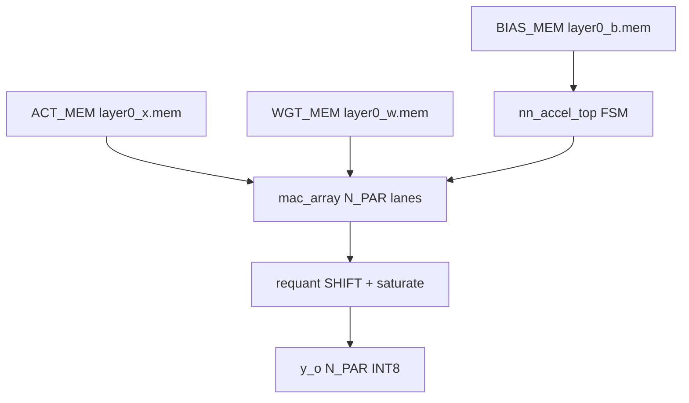

# Experiment 3: INT8 MAC Array (Quantized NN Accelerator)

## 1. Objective

Explain the technical problem, motivation, design goal, and expected outcome.

Quantized inference needs exact signed arithmetic and a reference model, otherwise DSP-mapping and fixed-point bugs hide. Goal: parameterized INT8 `mac_unit` + `mac_array` + FSM `nn_accel_top` that runs a quantized layer (16x8 matmul, layer0) and matches an independent NumPy golden bit-exactly. Expected: known-answer `3*(-7)+5*11=34` passes, full tile matches `layer0_y_exp.mem`, back-to-back re-arm works.

## 2. Block Diagram

Figure 1. Quantized accelerator datapath. FSM streams K_LEN pairs per lane, accumulates, requantizes by SHIFT, checks against NumPy reference.

**Images/block_diagram.png:** TODO — render Mermaid reproducibly to PNG. Genuine supporting plots already in `Images/`: `fig_ref_vs_exp.png`, `fig_weight_hist.png`, `03_quantized_nn_results.png`.

## 3. RTL Design

Top: `RTL/nn_accel_top.sv` (`nn_accel_top`, params N_PAR/K_LEN/SHIFT/ACCUM + ACT/WGT/BIAS mem paths). Retained original name; documented here instead of renaming to `top_module.v`.

Hierarchy:
- `mac_unit.sv` — signed MAC `acc_q <= acc_q + a_i*b_i` on `en_i`; explicit sign-extension by replication (not width-cast, which zero-extended in this tool); 2-cycle `valid_o` pipe (`v_q[1]`); `clr_i` sync clear. Maps to one DSP48E1 for 8x8.
- `mac_array.sv` — N_PAR parallel `mac_unit` lanes (sequential 1 MAC/cycle per lane by design).
- `nn_accel_top.sv` — tile FSM IDLE/COMPUTE/DONE; `$readmemh` weights/acts/bias; SHIFT requant; `y_o` lanes; `done_o`.

Signals: `clk_i`, `rst_ni` (async-assert sync-deassert), `clr_i`, `en_i`, `a_i/b_i` signed[7:0], `sum_o` signed, `valid_o`, `start_i`, `done_o`, `y_o`.

Clock/reset/timing: 100 MHz target; after last `en_i`, `sum_o` final next cycle (`valid_o` rises). No registered-product strand (fixed per TB trace: fresh product added same cycle).

Decisions: if/else not ternary for accumulate (avoids unsigned widening); `OUT_WIDTH=2*IN_WIDTH+clog2(ACCUM+1)` with elaboration check; single source of truth `layer0_params.svh` (NPAR/KLEN/SHIFT).

## 4. Simulation Results

Env: ModelSim 10.5b, `Simulation/run_sim.do`: `vlog -sv rtl/mac_unit.sv rtl/mac_array.sv rtl/nn_accel_top.sv tb/tb_mac_array.sv; vsim -c work.tb_mac_array -do "run -all; quit -f"`.

Methodology (`Testbench/tb_mac_array.sv` + `Testbench/vectors/`):
- M1 known-answer: drive on negedge, wait `valid`, expect 34.
- M2 full tile vs `reference_layer.py` golden (`layer0_y_exp.mem`) — bit-exact, no tolerance.
- M3 back-to-back re-arm after DONE (guards S_DONE→S_IDLE clear).

Observed: M1=34 OK; M2 bit-exact; M3 OK → `*** ALL CHECKS PASSED (tb_mac_array) ***` per STATUS-backed logs (`sim/mac_sim.log` in source). Waveform: use `vsim.wlf`/wave.do; no fabricated `waveform.png` included — TODO export from actual run.

Limits: sequential 1 MAC/cycle (far below peak DSP); only layer0 validated; INT4 RTL present but not exercised by vectors yet.

## 5. Hardware Implementation

Target: Basys 3 / Nexys A7 (Artix-7). Constraints in `RTL/basys3.xdc`, `RTL/nexys_a7.xdc` — TEMPLATE, verify vs Digilent master. Procedure: Vivado synth, check DSP count matches math in README, close 100 MHz timing, program, on-board check. Observations/resources: TODO — no Vivado run here; do not claim LUT/FF/BRAM/DSP.

## 6. Applications

Quantized CNN/MLP edge inference, DSP-budget teaching, fixed-point pipeline pattern, reference-model verification flow for NN accelerators.

## 7. Conclusion

Demonstrated bit-exact INT8 tile vs NumPy plus pipeline-correct MAC. Learned DSP sign-extension pitfalls and valid-pipe contracts. Limits: throughput, single-layer, INT4 untested. Future: 2nd-layer + INT4 vectors, parallel MAC tree, Vivado utilization + timing closure.

## References

- Xilinx DSP48E1 User Guide
- NumPy reference `scripts/reference_layer.py`, quantize `scripts/quantize_model.py`
- Source: `RTL/mac_unit.sv`, `RTL/mac_array.sv`, `RTL/nn_accel_top.sv`, `Testbench/tb_mac_array.sv`
