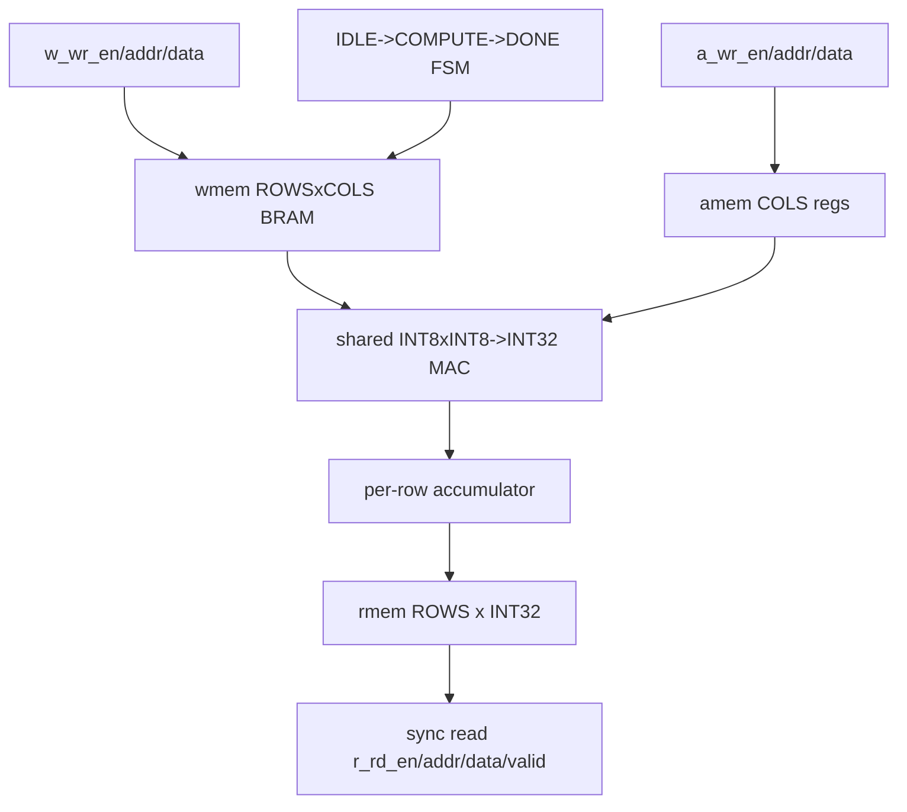

# Experiment 4: SRAM Processing-in-Memory (SRAM-PIM)

## 1. Objective

Model and implement a digital, synthesizable stand-in for an SRAM compute-in-memory macro on FPGA (which has no analog CiM primitive). Goal: BRAM-backed row-wise matvec `result[r]=sum_c(weight[r][c]*activ[c])` matching a bit-accurate Python golden, with correct sequencing, reset recovery, and result-read protocol. Expected: known-answer rows (92, 60), 30-seed random, corners, reset-mid-compute, B2B, optional Python golden cross-check.

## 2. Block Diagram

Figure 1. PIM approximation datapath. One weight read/cycle, 1-cycle BRAM latency consumed via pipe_valid, row-boundary write to rmem.

**Images/block_diagram.png:** TODO — render reproducibly. Genuine plots in `Images/`: `fig1_latency_scaling.png`, `fig2_throughput.png`, `fig3_acc_headroom.png`, `04_sram_pim_cnn_results.png`, plus `results_summary.csv` (in Documentation/figures).

## 3. RTL Design

Top: `RTL/pim_mac_bram.sv` (`pim_mac_bram`, NUM_ROWS/NUM_COLS/DATA_W/ACC_W). Retained name.

Memories: `wmem` ROWS*COLS x INT8 sync 1R1W BRAM (write port load, sync read 1-cycle → infers Block RAM); `amem` COLS x INT8 regs; `rmem` ROWS x INT32 regs.

FSM: IDLE→COMPUTE→DONE; COMPUTE issues one read/cycle (`issue_cnt` one bit wider than addr to hold terminal WDEPTH — fixes wrap bug), consumes next cycle (`pipe_vld`), accumulates, writes `rmem` at `col==NUM_COLS-1`; DONE sticks until next start. Result port sync 1-cycle (`r_rd_valid`).

Signals: `w_wr_en/addr/data`, `a_wr_en/addr/data`, `start`, `busy`, `done`, `r_rd_en/addr/data/valid`, `clk`, `rst_n`.

Clock/reset: 100 MHz, async-assert reset clears state/valid. Load ports allowed in IDLE/DONE, blocked mid-COMPUTE.

Decisions/honesty: labelled silicon-APPROXIMATION, not analog CiM (no bitline/ADC/variation). 1 MAC/cycle slow — interface unchanged if parallelized. No requantize (see Exp3). Documented in CONFIDENCE headers — review before hardware trust.

## 4. Simulation Results

Env: ModelSim, `Simulation/run_sim.do` (`vlog -sv rtl/pim_mac_bram.sv tb/pim_mac_tb.sv; vsim -c -suppress 3534 work.tb_pim_mac; log -r /*; run -all`).

TB (`Testbench/pim_mac_tb.sv`, independent `ref_row()` + optional `vectors/*.hex` from `model/pim_model.py`):
P1 known-answer 4x8 (row0=92, row1=60 hand-computed); P2 random x30; P3 corners (zeros, 127, -128, -128x127; checks (-128)*(-128)=+16384); P4 reset mid-compute + recover; P5 B2B + rd_valid latency + stray-start ignored; P6 Python golden if present.

Observed: RE-VERIFIED 2026-10-10 on submission-tree sources — `*** ALL CHECKS PASSED (tb_pim_mac) ***` across P1 (92/60 gates), P2 random x30, P3 corners, P4 reset-recover, P5 B2B/stray-start; P6 skipped (no `vectors/*.hex`). See `Simulation/rerun_2026-10-10.log`. Earlier `results_summary.csv` (`rtl_vs_golden_mismatches=0`) is consistent. No fabricated waveform PNG included.

## 5. Hardware Implementation

Target Nexys A7 (`RTL/nexys_a7.xdc` TEMPLATE — verify vs master). Vivado synth NOT run here. Procedure: synth, confirm BRAM inference for `wmem`, timing, program, FC golden check. Observations/resources: TODO — pending re-run + synth.

## 6. Applications

Memory-centric datapath modelling, CiM dataflow/sequencing proxy for Exp5, CNN matvec acceleration pattern, BRAM inference teaching.

## 7. Conclusion

Proved dataflow/arithmetic/sequencing the Exp5 block will expose, with strong self-checking. Limitation: approximation, paused verification, no hardware. Future: re-run sim, parallel MACs, requantize, Vivado BRAM + timing.

## References

- Xilinx Block RAM inference guide
- Python golden `model/pim_model.py`
- Source: `RTL/pim_mac_bram.sv`, `Testbench/pim_mac_tb.sv`, `Simulation/run_sim.do`
