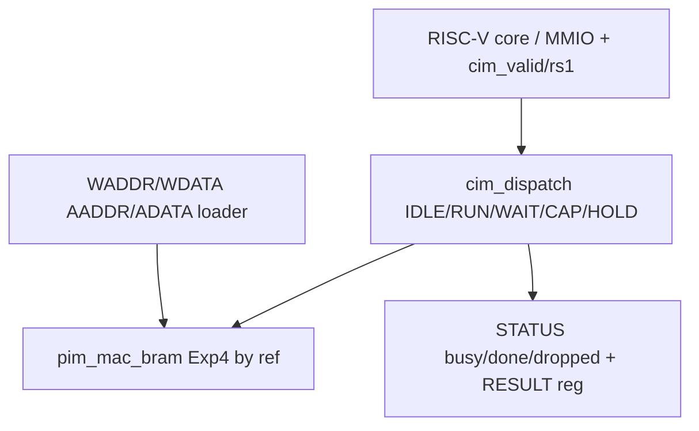

# Experiment 5: RISC-V SRAM Compute-in-Memory (SRAM-CIM)

## 1. Objective

Couple a RISC-V core to the Exp4 CiM engine via a custom-instruction dispatch layer, exposing loader/launch/status MMIO plus single-cycle launch. Problem: overlapping issue cannot backpressure a single-cycle base core, so dispatch must define ignore+flag semantics. Goal: `cim_dispatch` + `custom_instr_decode` + `soc_top_cim` wrapping `pim_mac_bram` by reference (never forked), with TB-proven loader, launch→busy→done→RESULT, dropped-flag, clamp, and reset recovery. Expected: row2 golden 272 (1..16 x all-2), clamp rs1=31→row15 =32, mid-run loader ignored, reset clears STATUS.

## 2. Block Diagram

Figure 1. Dispatch wiring. LOADER live in IDLE/HOLD only; LAUNCH level-based (not edge) so back-to-back CIM.RUN words both visible; RESULT captured 2 cycles after pim done (sync-read + capture; firmware polls done first).

**Images/block_diagram.png:** TODO — render reproducibly. Genuine summary plots in `Images/`: `05_riscv_sram_cim_accelerator_results.png`, `05_riscv_ai_accelerator_results.png` (sibling PROG-TaNi adaptation reference).

## 3. RTL Design

Top: `RTL/soc_top_cim.sv` (`soc_top_cim`); dispatch `RTL/cim_dispatch.sv` (`cim_dispatch`, NUM_ROWS=16/NUM_COLS=16/CIM_BASE 0x20000000); decode `RTL/custom_instr_decode.sv`. Retained names. `soc_top_cim` instantiates `riscv_core` + `mac_accelerator` (+ imem/dmem): source compiles these UNMODIFIED from sibling `05-riscv-ai-accelerator/rtl/`; this submission vendors those 10 files (`alu`, `branch_unit`, `control_unit`, `data_memory`, `instruction_memory`, `mac_accelerator`, `pc`, `register_file`, `riscv_core`, `system_top`) into `RTL/` so `tb_soc_top_cim` elaborates — provenance: verbatim copies, additively used. Likewise `pim_mac_bram.sv` logic is Exp4's engine (copied by value into this self-contained submission; canonical source `Experiment-4-Intermediate/RTL/pim_mac_bram.sv`).

MMIO (base stripped): 0x00 WADDR, 0x04 WDATA, 0x08 AADDR, 0x0C ADATA, 0x10 STATUS {dropped,done,busy}, 0x14 RESULT. Loader writes honored in D_IDLE/D_HOLD only; mid-run ignored (TB-proven). Launch `cim_valid` level in accepting state = one launch; while busy → ignored + sticky `CIM_DROPPED`; relaunch clears. Row select clamped to NUM_ROWS-1 (rs1=31→row15). RESULT of unwritten row = whatever pim holds (X until loaded) — firmware loads every row it reads.

FSM: D_IDLE→D_RUN (pim_start pulse)→D_WAIT (pim_done)→D_CAP (sync-read sel row)→D_HOLD (result_reg<=pim_rdata). D_RUN arm records second CIM.RUN arriving next cycle as dropped (real SoC hazard shape).

Clock/reset: single 100 MHz, sync design; reset returns to IDLE, STATUS=0, dropped=0.

## 4. Simulation Results

Env: ModelSim via `Simulation/run_sim.py` / `run_tests.do` / `run_all.do` (compile Exp5 RTL + Exp4 `pim_mac_bram` + base-core files by reference). Benches: `tb_custom_instr_decode`, `tb_cim_dispatch`, `tb_soc_top_cim`.

TB (`Testbench/tb_cim_dispatch.sv`): T1 loader readback + idle STATUS 0; T2 full run row2→272 + busy + HOLD STATUS 0x2; T3 overlap→dropped 0x6 intact + T3b consecutive-cycle launches dropped + relaunch clears; T4 clamp→32; T5 mid-run loader ignored (still 272); T6 reset mid-run→STATUS 0 + recover→272. Independent in-TB `ref_dot()` (no shared DUT code), old-ModelSim-safe syntax.

Observed (fresh 2026-10-10, submission-tree sources; base-core RTL vendored from `05-riscv-ai-accelerator/rtl/` into `RTL/` with provenance noted in §3): `*** ALL CHECKS PASSED (tb_custom_instr_decode) ***` (E1 131072 / E2 32768 combos); `*** ALL CHECKS PASSED (tb_cim_dispatch) ***` (T2 row2 = 0x110 = 272, T4 clamp = 0x20 = 32, T3/T3b dropped = 0x6, T5 unaffected, T6 recover). `tb_soc_top_cim`: `*** FAILURES: 8 ***` — PC=X (want 0xF4), dmem/x-reg X — likely init/X-propagation in this ModelSim version; under investigation, NOT claimed. See `Simulation/rerun_2026-10-10.log`. No fabricated pass PNG included.

## 5. Hardware Implementation

Target: Basys 3 path noted for sibling (`scripts/synth_basys3.tcl` mentioned in STATUS) / Nexys A7 generic. Constraints: TODO — add/verify XDC pins vs Digilent master; `dmem` distributed-RAM note and OOB-drop behavior must be reviewed before synth. Vivado synth NOT run here. Observations/resources: TODO — pending.

Firmware: `RTL/main_cim.c` (actually `firmware/main_cim.c` copied to RTL/ per mapping — see source `firmware/`); assembler-only flow (no riscv-gcc here); see `common/riscv-toolchain.md` pattern.

## 6. Applications

Custom-ISA co-processor pattern, CiM offload for quantized layers, hazard-aware dispatch (drop-flag vs stall), SoC+CIM co-design teaching.

## 7. Conclusion

Dispatch layer fully specified and TB-proven in source; math inherits Exp4 confidence (paused). Limits: depends on Exp4 re-verify, no fresh sim log this pass, no synth. Future: re-verify Exp4 → run all three TBs → Vivado synth + `board_top` + XDC verify → on-board FC golden.

## References

- RISC-V custom-instruction encoding, Exp4 `pim_mac_bram`
- Source: `RTL/cim_dispatch.sv`, `RTL/custom_instr_decode.sv`, `RTL/soc_top_cim.sv`, `Testbench/tb_cim_dispatch.sv`, `Simulation/run_tests.do`
